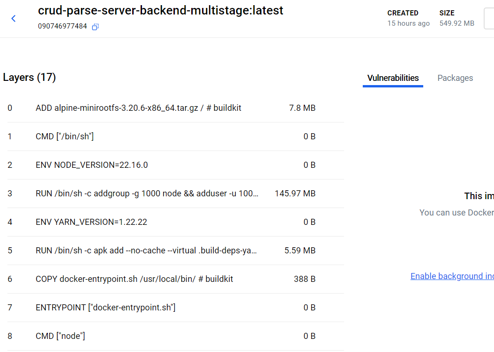
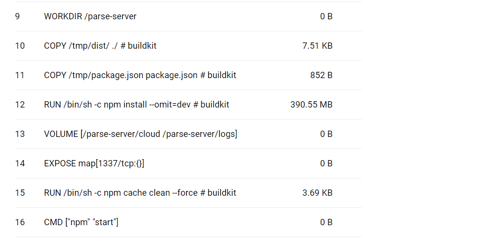

# CRUD-parse-server-backend

Parse Server backend for the Items CRUD demo, written in TypeScript. Provides
the REST API (via Parse Server) that the `CRUD-nextjs-frontend` app talks to:
user registration/login (Parse `_User`) and CRUD on an `Item` class, scoped
to the logged-in user via ACLs.

## Requirements

- Node.js 18+
- A running MongoDB instance

## Project layout

- `src/index.ts` — Express + Parse Server bootstrap, mounted at `/parse`,
  plus a `GET /health` endpoint.
- `src/cloud/main.ts` — Cloud Code triggers for the `Item` class.
- Compiles to `dist/` (see `tsconfig.json` — `rootDir: src`, `outDir: dist`).

## Setup (without Docker)

```bash
npm install
cp .env.example .env
# edit .env if needed, then make sure MongoDB is running locally

npm run dev    # runs src/index.ts directly, restarts on change
# or
npm run build && npm start   # compiles to dist/ and runs the compiled output
```

The server listens on `PORT` (default `1337`) and mounts the Parse REST API
at `SERVER_URL`'s path (default `/parse`), e.g. `http://localhost:1337/parse`.

A plain health check is available at `GET /health`.

## Notes

- `APP_ID` / `MASTER_KEY` in `.env.example` are placeholder dev values — change
  them for anything beyond local testing.
- `src/cloud/main.ts` enforces that a user must be logged in to create/edit
  items, validates the `name` field, and sets each item's ACL so users can
  only see and modify their own items.

#Dockerfile

The dockerfile in this crud parse server backend project branch doesn't contains a single stage build dockerfile which doesn't take optimization into consideration. These are the lines which make up the layers in the final image

FROM node:jod-alpine3.20 AS build

WORKDIR /tmp

COPY package\*.json .

RUN npm install

COPY . .

RUN npm run build

RUN npm cache clean --force

FROM node:jod-alpine3.20 AS release

WORKDIR /parse-server

COPY --from=build /tmp/dist/ ./

COPY --from=build /tmp/package.json package.json

RUN npm install --omit=dev

VOLUME ["/parse-server/cloud", "/parse-server/logs"]

EXPOSE 1337

RUN npm cache clean --force

CMD [ "npm", "start" ]

The final image had a size of 549.92 MB



